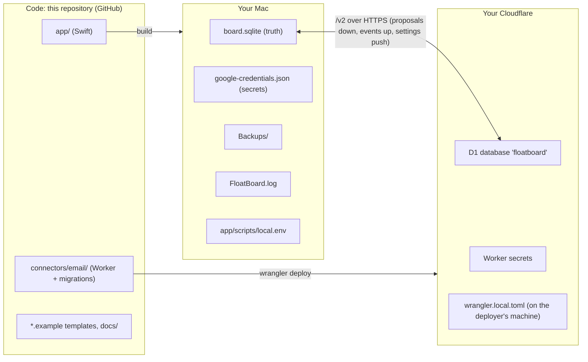
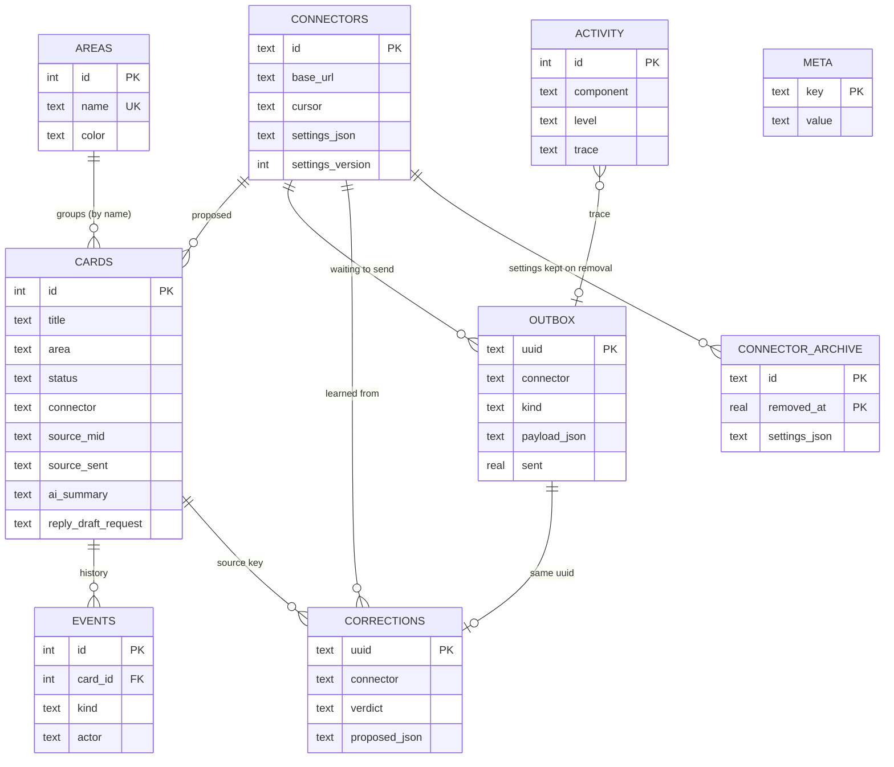
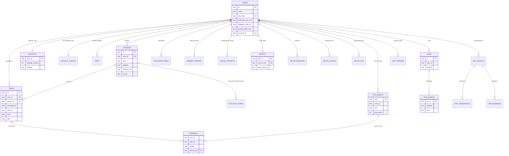

# FloatBoard data model

Where every piece of FloatBoard data lives, what it means, how the pieces relate, and which of it is personal.

The rule behind all of it: **GitHub holds only code.** Your data and your personal values live on your Mac or in your
own Cloudflare account, never in this repository. The app's database on your Mac is the single source of truth for
your tasks; the email engine only proposes.

Two checks keep this page honest: `FloatBoardChecks` fails if a table of the board database is not named here, and the
engine test `connectors/email/test/data-model.test.ts` fails if a table created by the migrations (and not dropped
later) is not named here. If you add a table, add it to this page.

Words used below:

| Word | Meaning |
|---|---|
| **App** | The FloatBoard Mac app (`app/`). |
| **Engine** | The optional email connector (`connectors/email/`): a Cloudflare Worker plus a D1 (SQLite) database, run in *your* Cloudflare account. |
| **Board** | The app's database, `board.sqlite`. |
| **Proposal** | Something the engine suggests to the app (a task, a meeting summary, learned preferences ...). |
| **Event** | Something the app tells the engine (a task was done, deleted, changed ...). |
| **Personal** | Holds content about you or from your email (names, addresses, subjects, task text), or a secret. |

---

## 1. The three places



### 1a. Code: this repository

No data and no personal values. Anything personal that a build or deploy needs is read from a git-ignored local file,
for which the repository holds only an `.example` template with placeholders.

| Item | Holds | Personal? | Notes |
|---|---|---|---|
| `app/` | The Mac app's source, checks and fixtures (`app/Tests/Fixtures/*.json`, made-up values only). | No | |
| `app/Sources/FloatBoardCore/LocalData.swift` | The list of every local location the app uses and its override variable. | No | The boundary in code: the app writes nowhere else. |
| `app/scripts/local.env.example` | Template for `app/scripts/local.env`. | No | Placeholders only. |
| `connectors/email/` | Engine source, `migrations/*.sql` (the D1 schema, applied in order), tests with fake values. | No | |
| `connectors/email/wrangler.toml` | Deploy config with a zeroed `database_id`. | No | |
| `connectors/email/wrangler.local.toml.example` | Template for your own deploy config. | No | Placeholders only. |
| `connectors/email/.dev.vars.example` | Names of the engine's secrets, empty values. | No | `.dev.vars` (local dev secrets) is git-ignored. |
| `connectors/email/src/skills/email-triage.md` | The shared triage skill every engine uses. | No | Nothing personal; your own rules live in the board. |
| `docs/`, `connectors/outlook-web/PLAN.md` | This page and the Outlook connector build plan. | No | |

Git ignores: `app/scripts/local.env`, `connectors/email/wrangler.local.toml`, `connectors/email/.dev.vars`,
`node_modules`, `.wrangler/`, `.build/`, `build/`, `dist/`.

### 1b. Your Mac

All paths come from `LocalData` (`app/Sources/FloatBoardCore/LocalData.swift`). `<support>` is
`~/Library/Application Support/FloatBoard/`.

| Item | Path (override) | Holds | Owner / source of truth | Personal? | Created by | Sync (direction) | Backup |
|---|---|---|---|---|---|---|---|
| Board database | `<support>/board.sqlite` (`FLOATBOARD_DB`) | Cards, history, groups, connectors and their settings, outbox, corrections, Activity log (see section 2). | **The app. This is the truth.** | Yes | The app, on first launch (schema in `DB.swift`, upgraded in place). | Proposals in from the engine; events and settings out to it (section 4). | Tiered snapshots in `Backups/`. |
| Credentials file | `<support>/google-credentials.json` (`FLOATBOARD_CREDS`) | `connector-key:<id>` (each engine's user key); optional Google Calendar sign-in (`client-id`, `client-secret`, `refresh:<email>`). Owner read/write only (0600). | The app | Yes (secrets) | The app, when you add a connector or sign in to Calendar. | None. The engine key is only sent as the `Authorization` header. | **Not backed up.** If lost, open the engine's setup page and press *Connect to FloatBoard* again. |
| Backups folder | `<support>/Backups/` (`FLOATBOARD_BACKUPS`; none when only `FLOATBOARD_DB` is set) | `board-<yyyyMMdd-HHmmss>-<reason>.sqlite`: verified copies of the board. | The app | Yes (copies of the board) | The app: at launch, every 6 hours, before a schema upgrade, a re-check or a restore. | None (local only). | Daily 14, weekly 8, monthly 12; pre-migrate / pre-recheck / pre-restore kept 90 days. |
| Diagnostic log | `~/Library/Logs/FloatBoard.log` (no override) | Window-avoider lines: time, window sizes, state. | The app | No (no task text) | The app, when it moves windows clear of the bar. | None | None |
| Build settings | `app/scripts/local.env` (from `local.env.example`) | `BUNDLE_ID`. | You | Yes (your identifier) | You, by copying the template. | None | Your own |
| macOS preferences | `~/Library/Preferences/<bundle id>.plist` | Device settings: `barConfig` (+ `barConfig.broken`), `boardPinned`, `avoidWindows`, `axPrompted`, `googleAccounts` (Calendar account addresses). | The app | `googleAccounts` only | The app | None | None (device settings, not user data) |
| CSV export | `~/Downloads/` | Cards and history, when you choose *Export to CSV*. | You | Yes | You | None | Your own |

### 1c. Your Cloudflare

| Item | Where | Holds | Owner / source of truth | Personal? | Created by | Sync (direction) | Backup |
|---|---|---|---|---|---|---|---|
| D1 database `floatboard` | Your Cloudflare account | Engine working state per user: inboxes, proposals (`items`), events from the app, a versioned **copy** of your settings, corrections for learning, run logs, setup sessions (section 3). | The engine for its working state; **a copy** for settings and corrections (the app holds the truth). | Yes | `npx wrangler d1 create floatboard`, then `migrations apply`. | Proposals down to the app; events and settings up from it. | Cloudflare D1 point-in-time restore. Nothing user-authored lives only here. |
| Worker secrets | Worker settings in Cloudflare | `ENC_KEY` (encrypts stored tokens and keys), `ADMIN_KEY`, optional `TELEGRAM_BOT_TOKEN`, `TELEGRAM_BOT_NAME`, `TELEGRAM_WEBHOOK_SECRET`. | You | Yes (secrets) | `npx wrangler secret put NAME`. | None | Your password manager (at least `ADMIN_KEY`). Losing `ENC_KEY` makes stored tokens unreadable: reconnect inboxes. |
| Per-user secrets in D1 | `users`, `sources`, `google_clients` columns ending `_enc` | Claude key, Gmail refresh tokens, Google client secret, Fathom key and webhook secret, the user's own Telegram bot token, all AES-GCM encrypted with `ENC_KEY` (the own bot's webhook secret is kept only as a SHA-256 hash). | The engine | Yes (secrets) | The engine's `/setup` page. | Never leave the engine. | With the D1 database. |
| Deploy config | `connectors/email/wrangler.local.toml` on the deployer's machine (from the `.example`) | Your real `database_id`, `workers_dev` choice. | You | Yes (account ids) | You, by copying the template. | Used by `wrangler ... --config wrangler.local.toml`. | Your own |

---

## 2. Ontology: the app (board.sqlite)

Every table, schema version 8 (`app/Sources/FloatBoardCore/DB.swift`, fixture `app/Tests/Fixtures/schema-v8.json`).

| Entity | Table | Meaning | Key fields |
|---|---|---|---|
| **Card** | `cards` | One task on the board. Never hard-deleted: `deleted` and `withdrawn` hide it. | `id`; `title`, `notes`, `area` (group name), `importance` (0-3), `due`, `status` (todo / doing / done), `created`/`started`/`done`/`updated`; Calendar link `gcal_*`; connector origin `connector`, `source_mid` + `source_sent` (source key), `external_id`, `source_link`, `source_meta` (JSON: `why`, `source_label`, `item_id`), `proposal_json` (the proposal as made), `ai_summary` (meeting notes, never mixed into `notes`), `imported_at`; reply draft `reply_draft_state` / `_link` / `_error` / `_request` / `_sent_at`. Unique index on (`connector`, `source_mid`, `source_sent`). |
| **History event** | `events` | One change to a card, with who made it. | `id`, `card_id`, `at`, `kind` (e.g. created, moved, "withdrawn by connector"), `from_status`, `to_status`, `actor` (`user` or `connector:<id>`), `uuid` (optional, unique). |
| **Group** | `areas` | A board group (column filter / colour). | `id`, `name` (unique, case-insensitive), `color`, `position`. Cards refer to it by name (`cards.area`). |
| **Applied marker** (unused) | `module_applied` | Left from an older import path; kept so new and upgraded boards have the same shape. | `external_id`, `at`. |
| **Activity entry** | `activity` | Everything the app did and every problem it hit (Help, Activity). | `id`, `at`, `component` (e.g. `outbox`, `connector:<id>`), `level` (info / warning / error), `message`, `detail`, `trace` (outbox uuid, proposal id or cursor), `seen`. |
| **Correction** | `corrections` | A judgement on a connector's proposal: deleted as "not an action" / "wrong details", or changed (group, importance, title, due); also a missed-email report arriving from the engine. Kept forever; learned preferences can be rebuilt from them. | `uuid` (same as the outbox row that carried it, or the proposal id), `connector`, `source_mid`, `source_sent`, `proposed_json`, `verdict`, `detail`, `at`. |
| **Outbox change** | `outbox` | One thing a connector still has to be told, written in the same transaction as the board change. | `uuid` (travels to the engine as `app_events.uuid`), `connector`, `kind` (done / deleted / changed / correction / settings / draft_reply), `payload_json`, `created`, `attempts`, `next_try`, `last_error`, `sent`, `detached` + `detach_reason` (no_connector / removed). |
| **Connector** | `connectors` | An engine this board talks to, plus **your settings for it** (the truth; the engine holds a copy). | `id` (from the connector name, e.g. `email`), `name`, `base_url`, `capabilities_json`, `cursor` (proposals cursor), `settings_json` (group notes, rules, lists, learned, default group, auto-add ...), `settings_version`, `engine_settings_version`, `last_ok`, `unreachable_since`, `status_json` (last `/v2/status`). The key is in the credentials file, not here. |
| **Archived connector settings** | `connector_archive` | A removed connector's settings, restored if the same id is added again. | (`id`, `removed_at`), `name`, `base_url`, `settings_json`, `settings_version`, `restored_at`. |
| **Meta value** | `meta` | Small key/value facts: `first_launch_at`, `connector_added:<id>`, `connected_since:<id>`, `pushed_time_zone:<id>` (device time zone last sent to that engine), `user_removed:<id>`, `health_open`, `health_ack` (watchdog state). | `key`, `value`. |
| (SQLite internal) | `sqlite_sequence` | SQLite's own counter for `AUTOINCREMENT` ids. | `name`, `seq`. |
| **Proposal** (not a table) | arrives over `/v2/proposals` | A suggestion from a connector. Applied to `cards` / `corrections` / `connectors.settings_json`; the original is kept in `cards.proposal_json`. | `id`, `kind` (task / summary / learned / withdraw / correction / draft), `source_key`, content, `provenance` (section 4). |
| **Backup** (not a table) | `Backups/board-*.sqlite` | A verified copy of the whole board. | Time stamp and reason in the file name. |

Relationships:

| From | To | Cardinality | Through |
|---|---|---|---|
| Card | History event | 1 to many | `events.card_id` |
| Group | Card | 1 to many | `cards.area` = `areas.name` |
| Connector | Card | 1 to many (0 for your own cards) | `cards.connector` = `connectors.id` |
| Connector | Outbox change | 1 to many | `outbox.connector` |
| Connector | Correction | 1 to many | `corrections.connector` |
| Outbox change | Correction | 1 to 0..1 | same `uuid` |
| Card | Correction | 1 to many | source key (`source_mid`, `source_sent`) |
| Connector | Archived connector settings | 1 to many (over time) | `connector_archive.id` |
| Activity entry | Outbox change / Proposal | many to 0..1 | `activity.trace` |



## 3. Ontology: the engine (D1)

Every table left by `connectors/email/migrations/*.sql` applied in order. Every row is scoped by `user_id` (one engine
can serve several people; each person's data is separate). `meeting_tasks` (0001) was dropped in 0017 and no longer exists.

| Entity | Table | Meaning | Key fields |
|---|---|---|---|
| **User** | `users` | One person using this engine. | `id`, `name`, `key_hash` (sha256 of the user key), `anthropic_key_enc`, `telegram_chat_id`, `link_code` (one-time Telegram link, for the bot the user links through), own Telegram bot (optional): `tg_bot_token_enc`, `tg_bot_name` (its @username), `tg_hook_id` (its webhook path `/telegram/webhook/u/<tg_hook_id>`), `tg_hook_secret_hash` (SHA-256 of its webhook secret); `ntfy_topic` (optional: random topic for phone alerts with the ntfy app, alerts POST to `https://ntfy.sh/<ntfy_topic>`); `created`. |
| **Source (inbox)** | `sources` | A connected Gmail inbox, Fathom webhook or Outlook on the web (Chrome extension). | `id`, `user_id`, `kind` (gmail / fathom / outlook_web), `address` (for Outlook: the mailbox, empty until the extension's first send), `refresh_enc`, `client_id` + `client_secret_enc` (older Desktop client), `fathom_key_enc`, `hook_id` (Fathom: the webhook path; Outlook: SHA-256 of the ingest token), `hook_secret_enc`, `enabled`, `cursor` (read position), `last_run` (Outlook: when the extension last reported), `last_error`. Unique (`user_id`, `kind`, `address`). |
| **Outlook row** | `outlook_rows` | An unread email the Outlook Chrome extension read from the user's Outlook tab, stored once until triage judges it; deleted 30 days after it was judged. | (`user_id`, `row_key` = `owa:<rowId>:<receivedISO>`), `source_id`, `from_name`, `from_addr`, `subject`, `preview` (the list preview: the only text Claude sees), `received` (ISO UTC), `processed`, `processed_at`, `created`. |
| **Recap key** | `recap_keys` | One id a stored meeting recap carried (Fathom share token `fathom:<token>`, or call number `fathom:call:<n>`), so the same meeting arriving by webhook, hourly catch-up or recap email is stored once. | (`user_id`, `key`), `created`. |
| **Item** | `items` | Something to propose to the app. `kind`: `action` (a task; sent as `task`), `summary` (meeting notes), `withdraw` (a re-checked email is no longer an action), `learned` (new learned preferences), `correction` (a missed email reported via Telegram), `draft` (the answer to a reply-draft request). | `id` (= proposal id), `user_id`, `source_id`, `message_id`, `sent_at` (source key), `kind`, `title`, `why`, `sender`, `subject`, `link`, `snippet`, `due`, `has_time`, `importance`, `group_name`, `task_ref`, `summary`, `critical`, `alerted`, `history_id` (Gmail), `created`. Unique (`user_id`, `message_id`, `kind`). |
| **Seen message** | `seen` | Emails already judged (so they are not judged twice). | (`user_id`, `message_id`), `at`. |
| **Feedback** | `feedback` | A correction the engine learns from (copy of the app's correction, with an email excerpt). | `user_id`, `item_id`, `verdict`, `detail`, `subject`, `sender`, `excerpt` (up to ~1,500 chars), `event_uuid` (unique), `consolidated`, `created`. |
| **Settings** | `settings` | The engine's **copy** of your connector settings, plus learning state. | `user_id`, `group_notes`, `groups`, `my_rules`, `learned`, `ignore_senders`, `allow_senders`, `unread_only`, `mark_read_on_done`, `ai_footer`, `alerts_on`, `critical_hours`, `learn_at`, `auto_add`, `time_zone` (IANA name sent by the app from the device; unset = UTC), `settings_version`, `learn_paused_at`, `learn_paused_rowid`. |
| **Run** | `runs` | One processing run (hourly cron or *Check now*). | `id`, `user_id`, `started`, `finished`, `processed`, `error`, `stopped`, `stats`, `calls`, `ms`. |
| **Run event** | `run_events` | One decision or error inside a run. | `run_id`, `user_id`, `at`, `source`, `sender`, `subject`, `decision`, `detail`, `trace` (item id or event uuid). |
| **App event** | `app_events` | An event received from the app's outbox, stored once by uuid then processed. | `uuid`, `user_id`, `kind`, `payload`, `received`, `processed` (0 waiting, 1 done, 2 failed), `attempts`, `last_error`. |
| **Missed report (pending)** | `missed_pending` | A Telegram "missed:" report matching several emails, waiting 30 minutes for the user's number. | `user_id`, `candidates_json`, `created`. |
| **Telegram message** | `telegram_inbox` | Every "missed:" or number message from a linked chat, stored before processing. | `update_id`, `user_id`, `chat_id`, `text`, `received`, `processed` (0 / 1 / 2 gave up), `attempts`, `last_error`, `last_try`, `pending_created`. |
| **Judge attempt** | `judge_attempts` | An email or recap whose Claude answer could not be read; retried, given up after 3. | (`user_id`, `message_id`), `attempts`, `last_error`, `subject`, `link`, `gmail_id`, `source_id`, `kind` (email / recap), `updated`. |
| **Setup session** | `setup_sessions` | A signed-in `/setup` browser session. | `id_hash`, `kind` (user / admin), `user_id`, `csrf`, `key_enc`, `expires`, `created`. |
| **OAuth state** | `oauth_states` | A Google sign-in in progress. | `state_hash`, `user_id`, `nonce_hash`, `expires`, `created`. |
| **Setup attempt** | `setup_attempts` | A sign-in attempt, for the rate limit. | `ip`, `at`, `ok`, `kind`. |
| **Google client** | `google_clients` | Each user's own Google Cloud Web client. | `user_id`, `client_id`, `client_secret_enc`, `updated`. |
| **Setup log entry** | `setup_log` | Every setup outcome (never secrets). | `at`, `user_id`, `ip`, `action`, `ok`, `detail`. |
| **Draft** | `drafts` | FloatBoard's Gmail reply draft for one email card, and exactly what it wrote. | (`user_id`, `source_mid`), `gmail_draft_id`, `body`, `to_addr`, `cc_addrs`, `subject`, `updated`, `locked`. |
| **Phone** | `app_devices` | A phone paired with the phone app (`/app`). Removing it on the setup page marks it revoked and deletes its sessions and passkeys. | `id`, `user_id`, `name`, `created`, `last_seen`, `revoked`. |
| **Phone passkey** | `app_credentials` | The passkey (WebAuthn credential) a phone signs in with. | `credential_id` (base64url), `device_id`, `user_id`, `public_key` (base64url COSE key), `counter` (signature counter), `transports` (JSON), `created`. |
| **Phone session** | `app_sessions` | A signed-in phone (the `fb_session` cookie, 90 days, renewed on use). | `token_hash` (SHA-256 of the cookie value), `device_id`, `user_id`, `created`, `expires`, `last_used`. |
| **Pairing code** | `app_pairings` | A one-time phone pairing link made by the Mac (valid 10 minutes, one device per code). | `code_hash` (SHA-256 of the code), `user_id`, `expires`, `used`, `challenge` (the passkey registration challenge). |
| **Sign-in challenge** | `app_challenges` | A passkey sign-in in progress (valid 5 minutes, used once). | `id`, `challenge`, `purpose` (login), `expires`, `used`. |

Relationships:

| From | To | Cardinality | Through |
|---|---|---|---|
| User | Source | 1 to many | `sources.user_id` |
| User | Settings | 1 to 1 | `settings.user_id` |
| User | Google client | 1 to 0..1 | `google_clients.user_id` |
| Source | Item | 1 to many | `items.source_id` (none for `learned`) |
| Source (Outlook) | Outlook row | 1 to many | `outlook_rows.source_id` |
| Outlook row | Item | 1 to 0..1 | `items.message_id` = `outlook_rows.row_key` |
| Item | Feedback | 1 to many | `feedback.item_id` |
| App event | Feedback | 1 to 0..1 | `feedback.event_uuid` |
| Run | Run event | 1 to many | `run_events.run_id` |
| User | Item, Seen message, Feedback, Run, App event, Telegram message, Judge attempt, Draft, Outlook row, Setup session, OAuth state | 1 to many | `user_id` |
| User | Missed report (pending) | 1 to 0..1 | `missed_pending.user_id` |
| Draft | Item (kind `draft`) | 1 to 1 per card | `source_mid` = `items.message_id` |
| User | Phone, Pairing code | 1 to many | `app_devices.user_id`, `app_pairings.user_id` |
| Phone | Phone passkey, Phone session | 1 to many | `device_id` |



`SEEN`, `TELEGRAM_INBOX`, `MISSED_PENDING`, `JUDGE_ATTEMPTS`, `SETUP_SESSIONS`, `OAUTH_STATES`, `GOOGLE_CLIENTS` and
`SETUP_LOG` are shown with their links only; `setup_attempts` (keyed by IP) belongs to no user.

## 4. The flows between them

All traffic is HTTPS + JSON under `/v2`, started by the app, authenticated with the user key from the credentials file.

| Flow | Direction | Endpoint | What travels | Durability |
|---|---|---|---|---|
| Events | App to engine | `POST /v2/events` | Outbox rows (`uuid`, `kind`, payload: `source_mid`, `source_sent`, `item_id`, `verdict`, `detail`, `at`, `notes`, `request_id`). | Outbox row written with the board change; marked sent only when the engine acks its uuid; retried with back-off forever. The engine stores each uuid once (`app_events`). |
| Settings push | App to engine | `PUT /v2/settings` | Full settings from `connectors.settings_json` (minus app-only keys) plus the board's group names (`groups`) and the device time zone (`time_zone`), with `settings_version`. | A newer engine version answers 409; the app bumps and resends. The engine reports back the version it uses. |
| Proposals | Engine to app | `GET /v2/proposals?after=<cursor>` | `items` as proposals. | Cursor saved only after the page is applied; re-delivery is skipped by `id` / source key. |
| Status | Engine to app | `GET /v2/status` | `settings_version`, settings form schema, `needs_attention`, `waiting`, `last_run_ok`, `last_run_error`, `oldest_unprocessed_event`. | Stored in `connectors.status_json`; used by the watchdog. |
| Commands | App to engine | `POST /v2/run`, `/v2/recheck?days=N`, `/v2/drafts/run` | Nothing personal. | Re-check never deletes; the app backs up first. |
| Export | Engine to caller | `GET /v2/export` | Settings and feedback, to rebuild an engine. | |

```mermaid
sequenceDiagram
  participant App as App (board.sqlite)
  participant Eng as Engine (D1)
  participant Ext as Gmail / Fathom / Claude / Telegram
  Ext->>Eng: hourly run reads new email and recaps
  Eng->>Eng: judge with Claude, write items
  Note over App: you change a card: outbox row in the same transaction
  App->>Eng: POST /v2/events (outbox, oldest first)
  Eng-->>App: acked uuids, rows marked sent
  App->>Eng: PUT /v2/settings (version N)
  Eng-->>App: ok, settings_version N (or 409 newer)
  App->>Eng: GET /v2/proposals?after=cursor
  Eng-->>App: items + next cursor
  Note over App: apply to cards, corrections, settings; then save cursor
  App->>Eng: GET /v2/status
  Eng-->>App: settings_version, needs_attention, last_run_ok
  Eng->>Ext: mark read, write reply drafts, Telegram alerts
```

How each proposal kind lands in the board:

| Proposal kind (engine item kind) | Effect in the app |
|---|---|
| `task` (`action`) | New card, or refresh an untouched card with the same source key. |
| `summary` | Written to the matching card's `ai_summary`. |
| `withdraw` | An untouched card is hidden (`withdrawn`), kept and restorable; a touched card is left alone. |
| `learned` | Replaces `learned` in `connectors.settings_json` and bumps `settings_version`. |
| `correction` | A row in `corrections` (never a card). |
| `draft` | Sets the card's `reply_draft_*` fields, only if `task_ref` equals the card's current request. |

## 5. Identifiers that cross the boundary

| Identifier | Format | Generated by | Used for |
|---|---|---|---|
| **Source key** | `{ message_id, sent_at }`: the email's RFC Message-ID and its sent time (ISO UTC, the same in every inbox). Meeting follow-ups use `<Message-ID>#<n>`. `sent_at` is null for items made before migration 0007, which match by message id alone. | Engine (read from the email); stored in the app as `cards.source_mid` + `cards.source_sent`. | Matching a proposal to a card without trusting engine ids; one card per email even across inboxes; re-check reconciliation; corrections. |
| **Proposal id** | UUID | Engine (`items.id`) | Dedupe of proposals; stored in card metadata as `item_id`; sent back in events; Activity `trace`. |
| **Event uuid** | UUID | App (`outbox.uuid`) | Idempotent intake (`app_events.uuid`); `feedback.event_uuid`; Activity / `run_events` trace end to end. |
| **request_id** | lower-case UUID | App (when you press *Draft reply*; `cards.reply_draft_request`) | Sent in the `draft_reply` event; returned as the `draft` proposal's `task_ref`; an answer to an older request is ignored. |
| **settings_version** | whole number, starts at 1 in the app | App (`connectors.settings_version`, +1 on every settings change and every learned update) | Sent with `PUT /v2/settings`; the engine keeps the highest and reports it back (`connectors.engine_settings_version`). |
| **Proposals cursor** | `<created>\|<item id>\|<rowid high-water mark>`, e.g. `2026-01-01T09:00:00.000Z\|<uuid>\|42`. Opaque to the app. | Engine | `GET /v2/proposals?after=`; saved in `connectors.cursor` only after the page is applied. Items up to 2 minutes behind the cursor that committed late are re-sent; the app skips duplicates. |
| **Connector id** | lower-case letters, digits and dashes from the connector name (e.g. `email`) | App | `cards.connector`, `outbox.connector`, actor `connector:<id>`, credentials name `connector-key:<id>`. |
| **User key** | random secret | Engine (`/setup/admin` invite) | `Authorization` for `/v2`; the engine stores only its sha256 (`users.key_hash`), the app stores it in the credentials file. |

## 6. Personal data inventory

| Where | Fields with personal content | Kind | Retention / pruning |
|---|---|---|---|
| Board `cards` | `title`, `notes`, `ai_summary`, `source_link`, `link`, `source_meta` (why, inbox label), `proposal_json`, `gcal_account`, `reply_draft_link` | Task text, email-derived text, addresses | Kept forever (deleting only hides). |
| Board `events` | `kind` (may quote a changed field) | Change history | Kept forever. |
| Board `corrections` | `proposed_json`, `detail` | Email-derived text | Kept forever (rebuilds learning). |
| Board `outbox` | `payload_json` (source key, verdict, changed titles, draft `notes`) | Email-derived text | Kept after sending (no pruning today). |
| Board `connectors`, `connector_archive` | `settings_json` (group notes, own rules, sender lists, learned preferences), `base_url` | Preferences, addresses | Until removed; archived copy kept. |
| Board `activity` | `detail` (titles are left out of change details; errors may quote text) | Diagnostics | Pruned after 90 days. |
| Board `areas` | `name` | Your group names | Until you delete the group. |
| `Backups/` | Whole board | All of the above | 14 daily, 8 weekly, 12 monthly; special snapshots 90 days. |
| Credentials file | Engine keys, Google client secret, refresh tokens, account emails (in key names) | Secrets | Until removed in the app. |
| macOS preferences | `googleAccounts` | Account emails | Until signed out. |
| Engine `users` | `name`, `telegram_chat_id`, `anthropic_key_enc` | Identity, secret (encrypted) | Kept while the user exists. |
| Engine `sources`, `google_clients` | `address`, `*_enc` | Inbox address, secrets (encrypted) | Until the inbox is removed. |
| Engine `items` | `title`, `why`, `sender`, `subject`, `link`, `snippet`, `summary` | Email content | Kept (no pruning today). |
| Engine `feedback` | `subject`, `sender`, `detail`, `excerpt` (~1,500 chars of the email) | Email content | Kept (learning input). |
| Engine `settings` | `group_notes`, `groups`, `my_rules`, `learned`, `ignore_senders`, `allow_senders` | Preferences, addresses | Overwritten by each settings push. |
| Engine `seen` | `message_id` | Email ids | Kept; cleared for the window on re-check. |
| Engine `run_events` | `sender`, `subject`, `detail` | Email metadata | Pruned after 7 days. |
| Engine `runs` | `error` | Diagnostics | Pruned after 30 days. |
| Engine `app_events` | `payload` | Email-derived text | Failed rows pruned after 30 days; processed rows kept. |
| Engine `judge_attempts` | `subject`, `link` | Email metadata | Pruned after 30 days; cleared on re-check. |
| Engine `telegram_inbox` | `chat_id`, `text` | What you typed | Processed rows pruned after 30 days; given-up rows after 7 days. |
| Engine `missed_pending` | `candidates_json` (subjects, senders) | Email metadata | Replaced or deleted after 30 minutes. |
| Engine `drafts` | `body`, `to_addr`, `cc_addrs`, `subject` | Draft email content, addresses | Kept per card (no pruning today). |
| Engine `setup_sessions`, `oauth_states` | `key_enc` | Secret (encrypted) | Deleted when expired. |
| Engine `setup_attempts`, `setup_log` | `ip`, `detail` | Network address | Attempts pruned after 24 hours; log kept. |
| Engine `app_devices`, `app_credentials`, `app_sessions`, `app_pairings`, `app_challenges` | `name`, `public_key`, hashes | Phone name, public keys, hashed tokens (no secrets in clear) | Sessions, codes and challenges deleted when expired; removed phones keep only the revoked device row. |
| Code (this repository) | None | | Enforced by `.gitignore`, `.example` templates and the pre-commit deny-list. |
